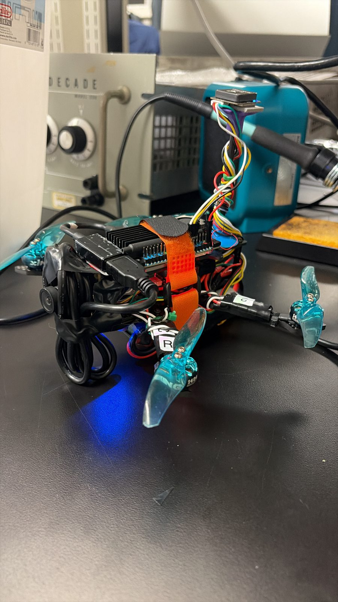
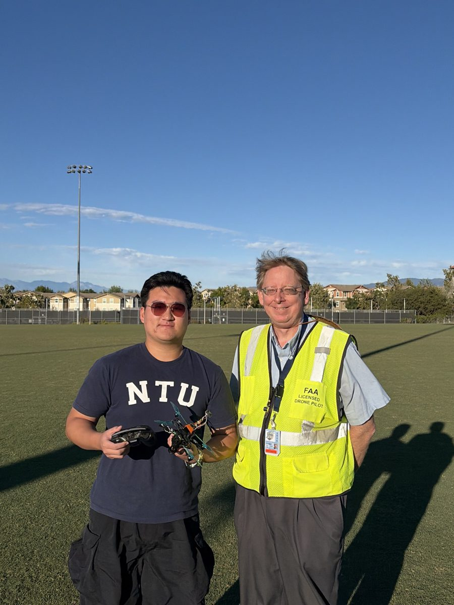

# Autonomous Vision Quadcopter

A 210 mm (4-inch) quadcopter built for UC Irvine's EECS 195 (completed with an A+), then extended
on my own with an onboard NPU for real-time detection, optical-flow positioning, and a
simulation stack for developing autonomy (MPC follow-me) before flight tests. The longer-term goal
is to bring the perception and autonomy of large autonomous drones down to a small, low-cost airframe.

  
  &nbsp;
  

## Demos
**Flight test with onboard NPU detection**

https://github.com/user-attachments/assets/b305bdeb-7360-40c8-a73c-a2e7d0981e52

**follow_track dry run**

https://github.com/user-attachments/assets/b9b99de0-3bd2-470d-8b97-984f997ece33

## Hardware
| Part | Details |
|---|---|
| Frame / props | 210 mm wheelbase, 4024 props, 2S 2200 mAh, ~380 g all-up |
| Flight controller | Matek F405-WMO, ArduCopter 4.7.2 (custom build, MatekF405-TE target) |
| Companion computer | Orange Pi Zero 3W (Allwinner A733, 3 TOPS Vivante VIP9000 NPU) |
| Camera | Innomaker U20CAM 1080p USB, MJPG 640x480 @ 30 fps |
| Positioning | GPS + compass; MicoAir MTF-01 optical flow + ToF rangefinder (MSP) |
| Radio | RadioMaster Pocket (ELRS) |
| Telemetry | ESP32-C3 running DroneBridge |

## Repository layout
| Folder | Contents |
|---|---|
| [`onboard/`](onboard) | Code running on the Orange Pi: CPU (ONNX Runtime) and NPU detection, follow-me, phone-triggered landing, LLM-in-the-loop agent, MAVLink utilities |
| [`sim/`](sim) | ROS 2 Jazzy + ArduPilot SITL + Gazebo: tracking experiments, MPC follow controller, camera-based target localisation |
| [`flight-controller/`](flight-controller) | ArduPilot parameter dump and build notes |
| [`drivers/ov9281_mipi/`](drivers/ov9281_mipi) | Porting an OV9281 global-shutter camera driver into the A733's VIN framework (for stereo VIO) |

## Highlights
**Edge AI on the NPU.** Converted YOLOv8n (Open Images V7, 601 classes) to the A733 NPU with
Allwinner's ACUITY toolkit. Fixed near-zero class scores by splitting the fused detection head
into separate box / class outputs (independent quantization scales) and by feeding planar CHW RGB
input. Wrote a C wrapper around the VIPLite driver with Python bindings: ~5 ms inference,
~8.4 ms per frame end-to-end, live detection at the camera's 30 fps (CPU baseline: ~10-15 fps).

**Sensor integration.** Built custom ArduCopter firmware with MSP optical-flow / rangefinder
drivers for the MTF-01. Debugged a boot failure caused by sensor data on the Pi's UART console
(U-Boot autoboot interrupt) and routed MAVLink through mavlink-router.

**Simulation-first autonomy.** In Gazebo, diagnosed why a vision follow-me controller lost the
target (self-detections of the drone's frame, tracker ID switches, unreliable box-height ranging,
drifting onto the person's walking line), then replaced it with a translational MPC (OSQP) that
holds a configurable standoff angle and a minimum-distance constraint:
mean 3.05 m to a 3 m target, minimum 2.84 m, ~2.8 ms per solve. The loop is now closed on the
camera instead of ground truth (camera-based target localisation, adaptive Kalman filter, CBF safety
layer), following both a line and a rectangle path at 4 m in the side position.

**LLM in the loop, checked in code.** An agent reads live battery voltage over MAVLink and asks an
LLM to answer LAND or HOLD; the reply is parsed and validated in Python before any LAND command is
sent.

**Camera driver bring-up.** The vendor BSP has no OV9281 driver, so I am porting one into
Allwinner's VIN camera framework to run two global-shutter cameras as a stereo pair for VIO/SLAM.

## Status
- [x] Manual / assisted flight, GPS, telemetry (EECS 195)
- [x] Onboard detection on CPU, then NPU at 30 fps
- [x] Optical flow + rangefinder on the flight controller
- [x] MPC follow-me in simulation (ground-truth target)
- [x] Camera-based target localisation closing the loop in simulation
- [ ] OV9281 stereo cameras on the A733 (driver port in progress)
- [ ] MPC follow-me on the real drone
- [ ] VIO/SLAM
