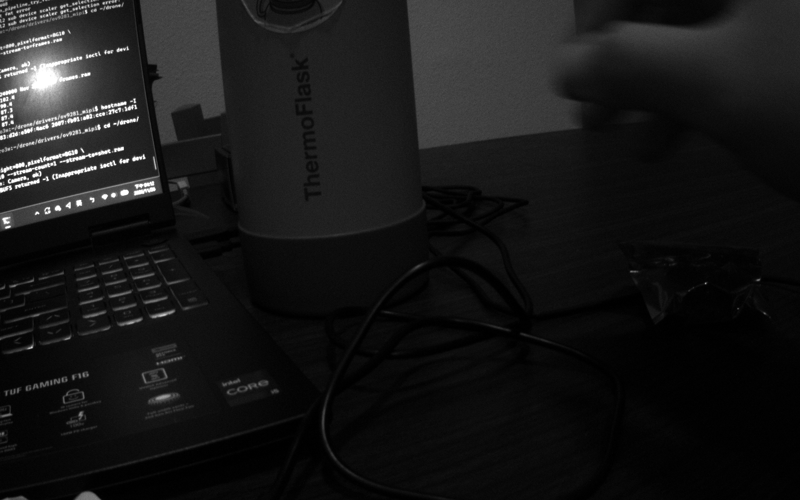

# OV9281 global-shutter camera driver for Orange Pi Zero 3W (Allwinner A733)

Goal: run two OV9281 mono global-shutter cameras on the Zero 3W's two MIPI CSI
ports as a stereo pair for onboard VIO/SLAM. The vendor BSP ships no OV9281
driver (officially only IMX219 is supported), so this folder ports one into
Allwinner's VIN camera framework.



*First frame (2026-11-26): 1280x800 mono RAW10 through MIPI CSI -> VIN, ISP
bypassed, contrast-stretched. The blurred hand is motion blur during the
~5.8 ms exposure; there is no rolling-shutter skew.*

## Status
- [x] Vendor camera stack confirmed working (VIN loads, both CSI ports probe)
- [x] On-board driver build environment (headers + vendor source + Kbuild)
- [x] Rebuilt the vendor IMX219 driver out-of-tree and loaded it successfully
- [x] `ov9281_mipi.c` v0.1 (chip-ID detect + 1280x800 RAW10 @ ~60 fps)
- [x] Device-tree user overlay for sensor0 (`overlay/make_overlay.sh`)
- [x] Chip ID 0x9281 read on hardware (CAM1)
- [x] First frames captured (mono RAW10, 1280x800)
- [x] Tools: `capture.sh` (auto-finds /dev/videoN) + contrast-stretched PNG
- [ ] Exposure / gain control from user space (next: `v4l2-ctl -d /dev/video0 -l`)
- [ ] sensor1 / CAM2 (overlay + scripts ready, not yet tested)
- [ ] Two cameras streaming, hardware-synchronised (external trigger)

## Platform
| Item | Value |
|---|---|
| Board | Orange Pi Zero 3W, 6 GB |
| SoC | Allwinner A733 (2x Cortex-A76 + 6x Cortex-A55, 3 TOPS NPU, E902 RISC-V) |
| Kernel | `6.6.98-sun60iw2` (vendor BSP) |
| Camera framework | Allwinner VIN (`vin_io.ko`, `vin_v4l2.ko`) |
| Vendor source | [`orangepi-xunlong/linux-orangepi`](https://github.com/orangepi-xunlong/linux-orangepi), branch `orange-pi-6.6-sun60iw2` |
| Camera | Innomaker CAM-OV9281RAW V2 (OV9281, 118° H FoV, external trigger) |
| Cable | 15-pin (1.0 mm) to 22-pin (0.5 mm) Pi Zero / Pi 5 camera FPC |

## Quick start (on the board)
```bash
source ~/drone-env/bin/activate   # Python venv (see "Python environment")
pip install -r requirements.txt   # numpy + pillow for raw2png.py
./setup.sh                    # build imx219.ko (reference) + ov9281_mipi.ko
./overlay/make_overlay.sh     # sensor0/1 -> ov9281_mipi(_2), addr 0xc0, ISP bypass
                              # (./overlay/make_overlay.sh 0 = CAM1 only)
sudo reboot
./test.sh                     # reload VIN with the driver, print dmesg
./capture.sh 5 frames         # CAM1: 5 frames -> frames.raw + frames_N.png
CAM=1 ./capture.sh 1 right    # CAM2 (second sunxi-vin node)
```
Expected from `test.sh`:
```
sunxi:vin:[INFO]: [ov9281_mipi][ov9281] found OV9281, chip id 0x9281
```

## Wiring (read this first)
A reversed cable shorts 3.3 V to GND and can burn the cable and camera.

- **Board end (22-pin, CAM1):** connector side of the Zero 3W facing up,
  **gold contacts facing up** (away from the board), stiffener towards the board.
- **Camera end (15-pin):** gold contacts face the **camera PCB**. With a cable
  whose contacts are on the same face at both ends, lay it flat without a
  twist: the Innomaker module (connector on the back) then sits **connector
  side down, lens up**.
- Push both ends fully in; insulate any exposed contacts (Kapton) and keep the
  cable away from the 40-pin header solder joints.
- Check before powering (multimeter, continuity): header pin 6 (GND) to camera
  connector pin 1 must beep, to pin 15 (3.3 V) must not.
- CAM1 = `sensor0`: CCI bus i2c-11 (PE7/PE8), MCLK1, PE6. CAM2 = `sensor1`: i2c-9.
- The Innomaker module's J1 matches the Raspberry Pi camera pinout, but pins
  11/12 are not connected: there is no enable pin, it powers up as soon as
  pin 15 has 3.3 V. The module carries its own oscillator (X1).

## Capturing
- VIN attaches the sensor to the pipeline only after `VIDIOC_S_INPUT`, and only
  for that open file handle. Input, format and streaming must therefore be one
  `v4l2-ctl` call with `-i 0`; without it `S_FMT` fails with `EINVAL` and a
  `vin_pipeline_try_format` warning in dmesg.
- With the ISP bypassed (`sensor0_isp_used = 0`) only RAW formats work; use
  `BG10`. NV12/GREY need the Bayer ISP.
- `VIDIOC_CREATE_BUFS returned -1` is harmless; v4l2-ctl falls back to REQBUFS.
- Frames are 1280x800 x 16-bit little-endian words (2 048 000 bytes each).
  `raw2png.py` converts them (`--rotate`, `--linear` options).

```bash
v4l2-ctl -d /dev/video0 -i 0 \
  --set-fmt-video=width=1280,height=800,pixelformat=BG10 \
  --stream-mmap --stream-skip=10 --stream-count=5 --stream-to=frames.raw
python3 raw2png.py frames.raw
```

## Python environment
`raw2png.py` (and the later VIO tools) run inside the existing **drone-env**
venv. The venv is separate from this repo: the repo lives in `~/drone`, the
venv in `~/drone-env` (outside git). Only the dependency list is tracked:

| File | Purpose |
|---|---|
| `requirements.txt` | Python packages the camera tools need (`numpy`, `pillow`) |

```bash
source ~/drone-env/bin/activate
pip install -r requirements.txt
```
The kernel module and shell scripts need no Python. `v4l2-ctl` comes from the
system package `v4l-utils`.

## Driver notes
- VIN has no Y10 media-bus path, so the mono RAW10 stream is reported as
  `SBGGR10_1X10`; the data are plain grey values.
- One mode: 1280x800, 2 lanes @ 800 Mbps, HTS 1456, VTS 1822, ~60 fps.
- Register tables come from mainline `drivers/media/i2c/ov9282.c`.
- Exposure/gain use VIN's Q4 convention (16 = 1 line / 1.0x). Default:
  642 lines (~5.8 ms), gain 1.0x. No auto exposure without the ISP, which is
  what VIO wants anyway (fixed, short exposure).
- `vin_io`'s `sensor_write_array()` may read one entry past an array while
  batching consecutive registers, so every table ends with a `REG_DLY, 0`
  sentinel.
- Debug parameter: `insmod ov9281_mipi.ko keep_power=1` leaves the sensor
  powered after probe so the bus and rails can be inspected
  (`i2cdetect -y -r 11`, multimeter on the camera connector).

## Debug log (what went wrong on the way)
1. `S_FMT` EINVAL: missing `VIDIOC_S_INPUT` (see Capturing).
2. No I2C ACK at 0x60 on every bus: cable inserted with the wrong face at one
   end. An earlier reversed insertion shorted 3.3 V and burned the first cable
   (the camera survived).
3. `make_overlay.sh` found nothing: `/proc/device-tree` is a symlink, so
   `find` needs a trailing slash.
4. A public report claims the A733 MIPI receiver never decodes packets on this
   board; that was not reproduced here.

## Device tree
`overlay/make_overlay.sh` builds one user overlay (`ov9281-sensors`) for the
live sensor nodes (found by their `sensorN_mname` property; sensor0 is
`/soc@3000000/vind@5800800/sensor@5812000`), installs it in
`/boot/overlay-user/`, and adds it to `user_overlays=` in
`/boot/orangepiEnv.txt`, replacing the older single-camera `ov9281-sensor0`.
The driver registers two names, `ov9281_mipi` (sensor0) and `ov9281_mipi_2`
(sensor1), like the vendor `imx219` / `imx219_2`. To undo it, remove that entry (from the UART console
or with the SD card in another computer) and reboot.

| Property | Vendor default | OV9281 |
|---|---|---|
| `sensor0_mname` | `imx219` | `ov9281_mipi` |
| `sensor0_twi_addr` (8-bit) | `0x20` | `0xc0` (7-bit 0x60) |
| `sensor0_isp_used` | 1 | 0 (mono RAW, bypass Bayer ISP) |
| `sensor1_mname` | `imx219_2` | `ov9281_mipi_2` |
| `sensor1_twi_addr` / `isp_used` | | `0xc0` / 0 |

## Build only
```bash
./setup.sh                 # headers, sparse vendor source, build into build/
sudo rmmod vin_v4l2        # VIN only probes sensors when it loads
sudo modprobe vin_io
sudo insmod build/ov9281_mipi.ko
sudo modprobe vin_v4l2
```
`loading out-of-tree module taints kernel` is expected. Building needs
Allwinner's own headers from `bsp/include` (e.g. `sunxi-log.h`), which the
headers package lacks; `Kbuild` adds that path.

## License
Everything in this folder is GPL-2.0, because the driver is derived from the
Allwinner vendor driver (`imx219.c`, GPL) and mainline Linux `ov9282.c`
(GPL-2.0-only). Original copyright notices are kept in the source files.
